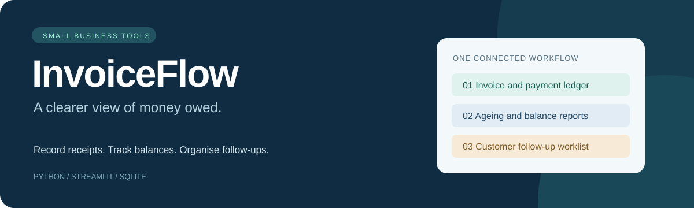
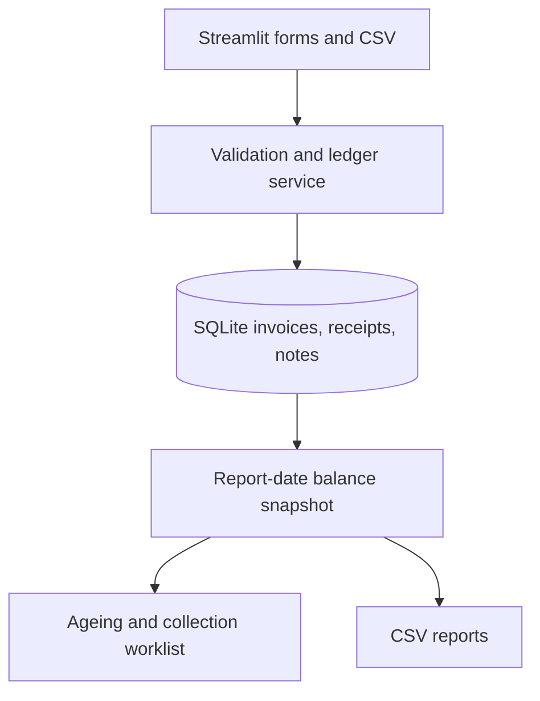

<div align="center">



# InvoiceFlow

**A local receivables workbench for small businesses.**

Python · Streamlit · SQLite · LKR · MIT

</div>

## The real-world problem

A small design studio, supplier or IT service business can issue invoices without knowing which ones have actually been paid. Partial receipts get lost in a spreadsheet, customer conversations live elsewhere, and staff spend time checking the same invoices again.

InvoiceFlow brings the invoice, payment history, unpaid balance and next follow-up into one place. It supports a practical single-user workflow without a paid API, a cloud account or a machine-learning model.

**Example:** A business records an LKR 100,000 invoice and receives LKR 30,000. The app keeps LKR 70,000 outstanding, places it in the correct overdue bucket, and lets the accounts assistant record a conversation and next follow-up date. Reports dated before that payment still show the earlier balance.

## Features

| Area | Working capability |
|---|---|
| Overview | Outstanding, overdue and received totals; ageing chart; contractual due schedule |
| Invoice register | Create invoices; filter by customer, invoice number or status |
| Payment ledger | Partial and full receipts, unique references, validation against overpayment |
| Collections | Explainable worklist, conversation notes and follow-up dates |
| Reminder drafts | Download editable reminder text; nothing is sent automatically |
| Reporting | Customer balances, invoice register and ageing reports as CSV |
| Import | UTF-8 CSV validation; reject the entire batch if any row is invalid or duplicated |
| Persistence | SQLite database survives app restarts; consistent downloadable backup |
| Demo | Fictional date-relative examples, kept separate from your business database |

## Quick start — Windows

Install Python **3.10 or later** first. Extract the project and open Command Prompt inside the folder containing `app.py`.

```bat
py -m venv .venv
.venv\Scripts\activate
python -m pip install -r requirements.txt
python -m streamlit run app.py
```

Open the local URL printed by Streamlit, normally `http://localhost:8501`. Choose **Demo business** to explore. Choose **My business** to start with an empty ledger.

### macOS / Linux

```bash
python3 -m venv .venv
source .venv/bin/activate
python -m pip install -r requirements.txt
python -m streamlit run app.py
```

The first installation needs internet access to download packages. Day-to-day invoice processing does not require an external API.

## Try the workflow in five minutes

1. Start in **Demo business** and look at the ageing chart.
2. Open **Invoices & payments**. Select a partially paid invoice and inspect its payment history.
3. Record a receipt with a new reference. Observe the outstanding balance fall.
4. Open **Collection worklist**, save a conversation note and a follow-up date.
5. Change **Balances as of** to yesterday. Today's receipts are excluded from that historical balance.
6. Download reports and a database backup.
7. Switch to **My business**. Its data starts empty and is separate from the demo.

Sample imports are in `sample_data/`. The sample dates are fixed examples; the in-app demo uses dates relative to the current day.

## Import format

Use exactly these headers in this order:

```csv
invoice_number,customer,email,issued_on,due_on,amount
INV-001,Example Customer,accounts@example.com,2026-10-01,2026-10-31,12500.50
```

- One currency: **LKR**, with up to two decimal places. No conversion is performed.
- Amounts must be positive, at most 999999999.99, and contain no currency symbol or thousands separator.
- Dates use `YYYY-MM-DD`. The due date cannot precede the issue date.
- Invoice numbers must be unique. Email is optional.
- Maximum 10,000 invoices per CSV and 5 MB per file.
- Imports are for invoice totals. Existing payments are entered separately in the payment form.
- Invoice amounts are final totals; the app does not compute tax or generate a legal tax invoice.

## How the numbers work

All money is stored in **integer cents**. Input is parsed using Python `Decimal`, avoiding floating-point balance drift. Display and charts convert cents to currency units only at the presentation boundary.

`balance = invoice total − receipts dated on or before the report date`

Only invoices issued on or before the selected report date are included. An invoice becomes overdue **the day after** its due date. The ageing bands are Current, 1–30, 31–60, 61–90 and 90+ days.

The contractual due schedule groups unpaid invoice balances by their due dates. It is **not a prediction of customer payments**. Received totals are cumulative across the invoices in the filtered view, not a monthly cash-flow measure.

Follow-up dates and notes show the **current** workflow even when financial balances are viewed historically. Worklist order is: follow-up due first, then days overdue descending, then balance descending, then invoice number. It does not claim to measure payment risk.

## Design



| File | Responsibility |
|---|---|
| `app.py` | User interface and workflow |
| `invoiceflow/ledger.py` | Validation, atomic database writes, snapshots, CSV and backups |
| `invoiceflow/analytics.py` | Aggregations, due buckets, worklist and reminder text |
| `invoiceflow/demo.py` | Fictional demonstration data |
| `tests/test_ledger.py` | Ledger correctness and edge cases |
| `tests/test_app.py` | Streamlit interaction checks |
| `docs/PROJECT_GUIDE.md` | Feasibility, scope and interview talking points |

SQLite foreign keys enforce relationships. Each payment obtains a write lock **before** reading the balance, so two simultaneous writes cannot both consume the same unpaid balance. A payment reference is unique per invoice. CSV imports run in a single transaction. Report CSVs escape formula prefixes in user-controlled text.

## Verification

Run from the folder containing `app.py`:

```bash
python -m unittest discover -s tests -v
```

**22 automated tests passed on Python 3.12** during creation: 18 ledger/report checks and 4 Streamlit interaction checks. The scenarios include partial/full payments, overpayment rejection, duplicate references, concurrent receipts, historical balances, atomic imports, ageing boundaries, backup integrity, persistence, empty states, invoice creation, payment entry and follow-up notes.

GitHub Actions is configured to run the suite on Python 3.10, 3.11 and 3.12. Those hosted runs have not been executed as part of this package. Browser screenshot verification was unavailable in the build environment; the supported Streamlit test harness verified UI interactions.

## Data, backup and scope

The app creates `data/demo.sqlite3` and `data/business.sqlite3`. These files are excluded from Git. To use another location, set `INVOICEFLOW_DATA_DIR` before starting the app.

For backup, use **Import & backup → Prepare database backup → Download SQLite backup**. To restore, stop Streamlit, keep a copy of the current database, then replace the appropriate database file in `data/` with the downloaded file and restart. Do not restore into a running app.

This version is designed for **one trusted local user**. It has no sign-in, encryption at rest, role-based access, bank integration, payment processing, automated sending, tax engine or multi-currency support. Receipts are append-only in the UI; credit notes, reversals and invoice editing are future work. Keep your original invoice and bank records as the source of truth. A public or multi-user deployment needs authentication, secure hosting and a reviewed persistence strategy before real customer data is entered.

## Upload to your GitHub

Suggested repository name: **invoiceflow**

Suggested description: **Small-business invoice and payment tracker with historical balances, ageing reports, collection follow-ups and SQLite persistence. Built with Python and Streamlit.**

### GitHub website

1. Create a new public repository named `invoiceflow` on your GitHub account.
2. Extract this ZIP. Open the inner `invoiceflow` folder.
3. Choose **Add file → Upload files** and upload the project contents, including folders. Do not upload only the ZIP. If your file picker omits dotfolders, use GitHub Desktop to include the workflow and configuration.
4. Confirm `app.py`, `requirements.txt` and `README.md` appear at the repository root.
5. Commit the files. Do not upload `.venv/`, `data/`, customer files or backups.

### Git command line

Create an empty repository first, then run inside the extracted project folder:

```bash
git init
git add .
git commit -m "Build InvoiceFlow receivables workbench"
git branch -M main
git remote add origin https://github.com/harshadulshan/invoiceflow.git
git push -u origin main
```

No repository has been published automatically. Review the code, run the demo, and update the documentation to reflect any changes you make.

## License

MIT. See [LICENSE](LICENSE).
